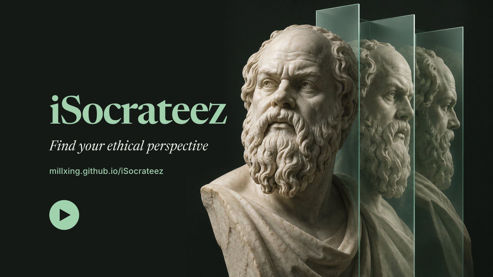

# iSocrateez

**Find your ethical perspective.**

Some decisions have no clean answer. iSocrateez helps you think one through. Describe your dilemma, choose the moral point of view you want to reason from, and get clear advice with the reasoning behind it.

  <a href="https://millxing.github.io/iSocrateez/promo.mp4"><b>▶ Watch the one-minute film</b></a>

## Try it

### **[Open iSocrateez → millxing.github.io/iSocrateez](https://millxing.github.io/iSocrateez/)**

It runs in your browser, on a phone or a computer. There is nothing to install. You need the shared passphrase to enter; ask the person who sent you here.

## How it works

1. **Describe a moral dilemma.** Use your own words, upload a text or Markdown file, or start from an example.

   > *My manager asked me to quietly adjust some figures so our team hits its target. I'm not comfortable, but pushing back could cost me my promotion. Should I do it, refuse, or report it?*

2. **Choose the perspective you want to reason from.**
   - **Yours.** Nine quick questions find where you stand.
   - **Your own settings.** Know where you stand? Set the three axes yourself.
   - **A great mind.** Hear from one of 40 thinkers and traditions, from Aristotle, Confucius, and Kant to Ubuntu and the Bhagavad Gita.

3. **Get advice grounded in moral philosophy.** Choose how it talks to you: plain language, some technical detail, or advanced.

## What you get

- **A direct answer.** What to do, said plainly.
- **The reasoning.** Why this advice follows from the perspective you chose.
- **What to watch for.** The risks and the blind spots.
- **A next step.** One thing you can do now.
- **Your ethical coordinates.** Where you sit between outcomes and principles, the individual and the collective, reason and intuition, and the school of thought nearest to you.
- **A debate.** Put two philosophers on your dilemma and read them test each other, or argue your own position against one of them.
- **A copy to keep.** Save the advice or the debate as a Markdown file.

## Yours alone

iSocrateez keeps no history. Your dilemma goes to an AI model to write the advice, and the app does not save it, on its server or in your browser. Reload the page and you start clean.

## A tool to think with

The philosopher voices are AI interpretations, not quotations. They can be wrong. iSocrateez gives you good reasons; the choice stays yours.

---

Working on the code? See the [development notes](docs/DEVELOPMENT.md).
